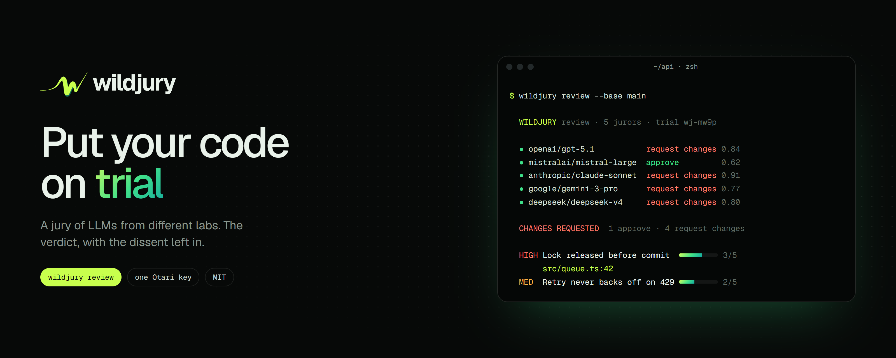
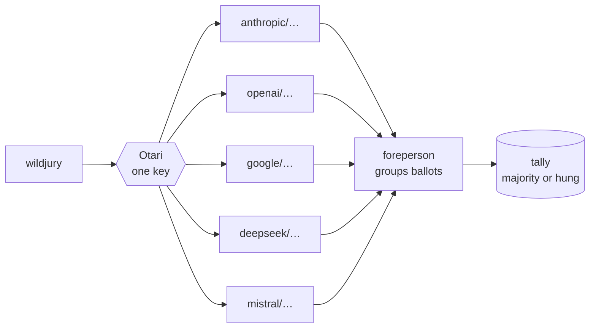

<p align="center">
  <a href="https://wildjury.cankat.art"></a>
</p>

<p align="center">
  <a href="https://wildjury.cankat.art"><b>Website</b></a> ·
  <a href="https://wildjury.cankat.art/docs"><b>Docs</b></a> ·
  <a href="#quickstart"><b>Quickstart</b></a> ·
  <a href="#ci-gate"><b>CI gate</b></a>
</p>

<p align="center">
  
  
  
  
</p>

---

One model is one set of blind spots. **Wildjury** asks models from different labs the same thing, each in private,
groups the answers that agree, and only calls a verdict when a strict majority holds. When nothing does, it says
**hung jury** instead of averaging. Every call goes through [Otari](https://otari.ai), so one key reaches every lab.

- **`ask`** any question, with files as context, and get the verdict plus the dissent.
- **`review`** your diff: findings ranked by how many jurors raised them.
- **Gate CI** on it: `review` exits `1` unless the jury approves.

## Quickstart

Needs Node 21+ and an Otari API key (otari.ai → API keys).

```bash
export OTARI_API_KEY=otk_...
npx github:enliven17/wildjury ask "Should our job queue use Postgres advisory locks?"
npx github:enliven17/wildjury review --base main
```

```
  WILDJURY  ask · 5 jurors · trial wj-mw9pbtzy-4c17

  ● anthropic/claude-sonnet-4.6    Yes, pg_advisory_xact_lock fits            0.90  4.1s
  ● openai/gpt-5.1                 Yes, advisory locks                        0.90  3.2s
  ● google/gemini-3-pro            Use SELECT … FOR UPDATE SKIP LOCKED        0.70  4.6s
  ● deepseek/deepseek-v4-pro       Yes, use advisory locks                    0.80  5.9s
  ● mistralai/mistral-large-3      Yes, advisory locks                        0.80  3.4s

  VERDICT  Use Postgres advisory locks for the job queue   4/5 agree · 80%
           Cheap, transaction-scoped, no extra infrastructure.

  DISSENT  Use SELECT … FOR UPDATE SKIP LOCKED   J3
           Row locks scale better for many workers.
```

<sub>Example output. Model ids come from your own Otari catalog.</sub>

## Commands

```bash
wildjury ask "Is this migration safe to run online?" -f migrations/042.sql
wildjury ask "What changed in the Node 24 fetch defaults?" --web
wildjury review                   # staged changes, else the working tree against HEAD
wildjury review --base main       # this branch against main
git diff | wildjury review -      # anything on stdin
wildjury models                   # what your key can seat, and the default jury
```

| Option | |
|---|---|
| `-m, --models a,b,c` | Exact jurors, by catalog id (`openai/gpt-5.1`) or `provider:model` |
| `-n, --jurors 5` | Size of the default jury |
| `-j, --judge model` | Foreperson who groups the ballots. Default: the first juror to answer |
| `-f, --file path` | Context for `ask`, repeatable |
| `--base ref` | Review `ref...HEAD` |
| `--web` | Let jurors search the web with Otari's built-in search |
| `--json` | Print the whole trial as JSON |

`OTARI_API_KEY` is required. `OTARI_BASE_URL` points at a self-hosted gateway; `WILDJURY_MODELS` fixes the jury.

## How a trial runs



1. **Empanel.** Read the Otari catalog and seat one mid-priced chat model per lab.
2. **Ballots.** Jurors answer in parallel, blind to each other, as JSON.
3. **Foreperson.** One model groups ballots that agree, or merges duplicate findings and lists who raised each. It does not vote.
4. **Tally.** Plain code, not a model. The largest group wins only with a strict majority of jurors who voted.

A juror that errors, times out or returns an unreadable ballot is **recused**; the trial goes on with the rest.

## CI gate

```yaml
# .github/workflows/jury.yml
on: pull_request
jobs:
  jury:
    runs-on: ubuntu-latest
    steps:
      - uses: actions/checkout@v4
        with: { fetch-depth: 0 }
      - uses: actions/setup-node@v4
        with: { node-version: 22 }
      - run: npx github:enliven17/wildjury review --base origin/main
        env:
          OTARI_API_KEY: ${{ secrets.OTARI_API_KEY }}
```

Exit codes: `0` approved (or `ask` finished), `1` changes requested or hung, `3` error.

## What Otari does

| | |
|---|---|
| **Catalog** | `GET /api/v1/models` is the jury pool: one key, every lab your workspace allows |
| **Routing** | Jurors are named by catalog id, so Otari picks the provider and fails over |
| **Traces** | Each juror sends its own `Otari-Conversation-Id` (`<trial>/juror-3`); read the trial ballot by ballot |
| **Web search** | `--web` declares `otari_web_search`; sources print from `otari_tool_calls` |
| **Budgets** | A refusal is shown with its `Retry-After` |

## Repository

| Path | |
|---|---|
| [`cli/`](cli) | The CLI: `otari.js` (gateway client), `jury.js` (trial and tally), `prompts.js`, `render.js`. No dependencies |
| [`site/`](site) | [wildjury.cankat.art](https://wildjury.cankat.art): Vite, React, GSAP, Lenis, an ASCII three.js hero, and the docs |
| [`brand/`](brand) | Logo built from code (`build-logo.mjs`), plus profile, banner and kit sheets rendered from HTML (`render.mjs`) |

```bash
npm test                          # CLI tests, no network
cd site && npm i && npm run dev   # the website
```

## License

[MIT](LICENSE). Illustrations in the Otari and CI sections are my own, also published on [illos.dev](https://illos.dev).
